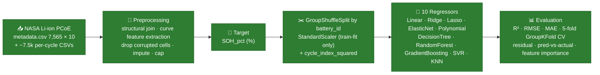
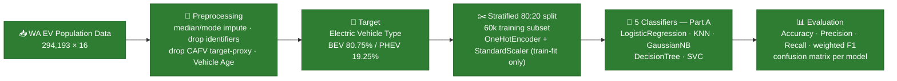
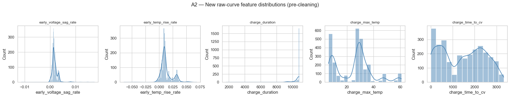
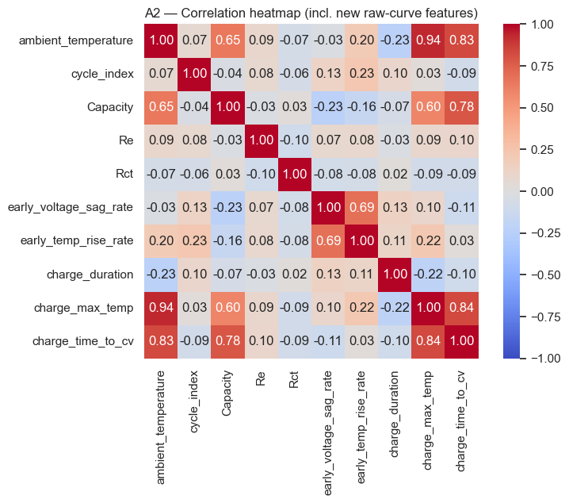

<div align="center">

# ⚡ ChargeIQ

### **Battery Health · Vehicle Classification · Charging Behaviour Analytics**

*Three independent Machine Learning tracks. Three angles on the EV ecosystem.*

<br>

[](https://www.python.org/)
[](https://scikit-learn.org/)
[](https://pandas.pydata.org/)
[](https://numpy.org/)
[](https://jupyter.org/)

[](#)
[](PROGRESS.md)
[](PROGRESS.md)
[](#-track-1--regression--battery-state-of-health)
[](#-track-2--classification--electric-vehicle-type)
[](#-results--all-10-algorithms)
[](#-results--all-5-part-a-algorithms)

</div>

---

## 💡 The Idea

An electric vehicle generates three completely different kinds of question. **ChargeIQ answers each with its own dataset, its own preprocessing and its own models** — the battery, the vehicle, and the driver.

| | Track | Real-world question | Target | Status |
|:-:|:--|:--|:--|:-:|
| 🔋 | **Regression** | *"How much life is left in this battery?"* | **State-of-Health (SOH, %)** — continuous | ✅ 10/10 |
| 🚗 | **Classification** | *"What kind of electric vehicle is this?"* | **`Electric Vehicle Type`** — BEV vs PHEV | ✅ 5/5 Part A |
| 🔌 | **Clustering** | *"What charging-behaviour archetypes exist among drivers?"* | *None — unsupervised* | ⬜ Review 2 |

> [!IMPORTANT]
> The three tracks are **fully independent**. Each has its own dataset, its own preprocessing, its own target and its own evaluation. Nothing is shared between them — no joint feature matrix, no joint split, no joint model.

> [!NOTE]
> For the Regression track the **single target is SOH (%)**, computed as `SOH_pct = 100 × Capacity / NOMINAL_CAPACITY`. Remaining Useful Life is *not* modelled anywhere in this project.

---

## 🧭 The Pipelines

### 🔋 Regression Track



### 🚗 Classification Track



### 🔌 Clustering Track — *Review 2*


---

## 🔋 Track 1 — Regression — Battery State of Health

**Notebook:** [`notebooks/regression.ipynb`](notebooks/regression.ipynb) · **Dataset:** NASA Li-ion Battery Aging (PCoE) · **Target:** `SOH_pct` (continuous, %)

<details open>
<summary><b>📦 Dataset</b></summary>

<br>

| | |
|:--|:--|
| **Source** | NASA Ames Prognostics Center of Excellence — cleaned Kaggle mirror `patrickfleith/nasa-battery-dataset` |
| **Structure** | `metadata.csv` (**7,565 × 10**) indexing ~7.5k raw per-cycle CSVs via its `filename` column |
| **Row types** | 2,815 charge · 2,794 discharge · 1,956 impedance |
| **Cells** | 34 batteries → **30** after dropping corrupted-log cells (B0049–B0052) → **2,694** usable discharge-cycle rows |
| **Target** | `SOH_pct` = `100 × Capacity / NOMINAL_CAPACITY` — range 19.8 % – 122.2 %, mean 68.1 % |
| **Local path** | `data/Regression_Dataset/` — see [Quickstart](#-quickstart) |

</details>

### Why SOH, and not raw Capacity?

Raw `Capacity` (Ah) is not comparable across cells with different nominal ratings. Normalising to **SOH % against nominal capacity** gives a target that is physically meaningful, comparable across every cell, and directly interpretable as *"how much of its original life does this battery still have?"*

### 🧠 The methodological core — *split by battery, not by row*

> [!NOTE]
> This is the most important design decision in the track, and the one to defend in the viva.

This is **panel data** — repeated cycles from the same ~30 batteries, not independent rows. Under a naive random row-level split, cycles from the *same* battery land in both train and test, and the model can partly fit battery-specific quirks through the `battery_id` one-hot column instead of learning the general physics. The scores look better; the question being answered is easier and less useful.

**The fix, applied throughout:**

- 🔒 **`GroupShuffleSplit` grouped on `battery_id`** — every cycle from a battery goes entirely into train *or* test, never both.
- 🚫 **`battery_id` dropped as a model feature** — a battery-level split makes it structurally unable to generalise to unseen cells.
- 📏 **`StandardScaler` fitted on the training split only.**
- 🔁 **`GroupKFold`** used for cross-validation and for polynomial degree selection, so grouping is respected there too.
- 🎲 **`random_state=42`** everywhere.

| | Batteries | Rows |
|:--|--:|--:|
| **Train** | 24 | 2,345 |
| **Test** *(fully unseen cells)* | 6 | 349 |
| **Overlap** | 0 | 0 |

### 🧬 Feature set — 10 features

| # | Feature | Origin | Intuition |
|:-:|:--|:--|:--|
| 1 | `ambient_temperature` | metadata | Test-protocol temperature group |
| 2 | `Re` | impedance rows | Electrolyte resistance — rises as the cell ages |
| 3 | `Rct` | impedance rows | Charge-transfer resistance — rises as the cell ages |
| 4 | `cycle_index` | derived | How many cycles this cell has been through |
| 5 | `early_voltage_sag_rate` | 🧪 raw discharge curve | Voltage drop in the first 300 s — degraded cells sag faster |
| 6 | `early_temp_rise_rate` | 🧪 raw discharge curve | Early self-heating rate |
| 7 | `charge_duration` | 🧪 raw charge curve | Total time to recharge |
| 8 | `charge_max_temp` | 🧪 raw charge curve | Peak temperature while charging |
| 9 | `charge_time_to_cv` | 🧪 raw charge curve | Time in constant-current before constant-voltage |
| 10 | `cycle_index_squared` | ⚙️ **engineered** | SOH fades in a **curve**, not a line |

> 💡 **Why only the *early* part of the discharge curve?** Capacity *is defined as* discharge current integrated over full discharge time — verified on one file: `0.995 A × (6179 s / 3600) ≈ 1.71 Ah` against that row's recorded `Capacity = 1.674 Ah`. A feature built from the full curve would restate the target rather than predict it. Restricting to the first 300 s keeps the physics and removes the leakage.

### 📈 Results — all 10 algorithms

Every model trained on the **same** preprocessed split and evaluated on the **same** held-out test set of 6 unseen batteries. RMSE and MAE are in SOH percentage points.

| Rank | Algorithm | Best parameters | R² ⬆ | RMSE ⬇ | MAE ⬇ |
|:-:|:--|:--|--:|--:|--:|
| 🥇 | **Gradient Boosting Regressor** | `learning_rate=0.1, max_depth=3, n_estimators=200` | **0.8153** | **8.0449** | 5.6427 |
| 🥈 | K-Nearest Neighbors Regressor | `n_neighbors=7, p=1, weights=distance` | 0.8013 | 8.3445 | **5.1617** |
| 🥉 | Random Forest Regressor | `max_depth=None, min_samples_leaf=4, n_estimators=200` | 0.7924 | 8.5277 | 5.5031 |
| 4 | Support Vector Regressor | `C=100, epsilon=0.1, kernel=rbf` | 0.7919 | 8.5396 | 6.5133 |
| 5 | Polynomial Regression | `degree=2` *(GroupKFold-selected)* | 0.7862 | 8.6539 | 5.9320 |
| 6 | Lasso Regression | `alpha=0.5` | 0.6820 | 10.5553 | 8.6171 |
| 7 | Linear Regression | *baseline* | 0.6671 | 10.7999 | 8.3770 |
| 8 | Ridge Regression | `alpha=100` | 0.6650 | 10.8331 | 8.8837 |
| 9 | ElasticNet Regression | `alpha=0.1, l1_ratio=0.1` | 0.6558 | 10.9816 | 9.1909 |
| 10 | Decision Tree Regressor | `max_depth=3, min_samples_leaf=1, min_samples_split=2` | 0.6525 | 11.0345 | 8.3325 |

**Best model: Gradient Boosting** — R² 0.8153, within ±5.64 SOH-points of mean absolute error on batteries it has never seen.

### 🔁 5-fold cross-validation — two best models

`GroupKFold(n_splits=5)` on `battery_id`, so folds never split a battery.

| Model | Fold 1 | Fold 2 | Fold 3 | Fold 4 | Fold 5 | **Mean** | **Std** |
|:--|--:|--:|--:|--:|--:|--:|--:|
| Gradient Boosting | 0.8998 | 0.9209 | 0.6566 | 0.8654 | 0.7764 | **0.8238** | 0.0971 |
| KNN | 0.8242 | 0.6071 | 0.7442 | 0.6381 | 0.6897 | **0.7006** | 0.0774 |

Gradient Boosting leads on mean CV R² by a clear margin (0.8238 vs 0.7006), and its cross-validated mean sits close to its test-set R² of 0.8153 — the held-out result is not a lucky split. Its fold-to-fold spread is slightly wider than KNN's (σ 0.097 vs 0.077), driven almost entirely by fold 3 (0.6566); batteries differ enough that any single fold can be hard.

### 🎛️ Hyperparameter tuning

`GridSearchCV` (5-fold) applied to Ridge, Lasso, ElasticNet, Polynomial degree, Decision Tree, Random Forest, Gradient Boosting, SVR and KNN. Before/after on the held-out test set:

| Model | Original R² | Tuned R² | Δ |
|:--|--:|--:|--:|
| Gradient Boosting | 0.8053 | 0.8153 | **+0.0100** |
| Decision Tree | 0.6672 | 0.6525 | −0.0148 |

Tuning improved one model and not the other — a genuine finding, kept in the notebook rather than hidden.

<details>
<summary><b>🔍 Two findings worth reading</b></summary>

<br>

**1 · Collinearity makes the linear coefficients lie.** In the Linear baseline, `cycle_index` and `cycle_index_squared` have the *smallest* coefficients (−0.41 and 0.81), while `charge_time_to_cv` (15.35), `charge_max_temp` (−8.59) and `ambient_temperature` (7.42) dominate. That is not "cycle count doesn't matter" — `ambient_temperature` correlates **0.94** with `charge_max_temp`, **0.82** with `charge_time_to_cv` and **−0.78** with `Rct`, because NASA's protocol fixes a matching charge/discharge regime per temperature group. Those features largely stand in for *which temperature group a cell belongs to*, and the collinearity even flips coefficient signs relative to each feature's own simple correlation with SOH.

**2 · Polynomial degree must be validated, not assumed.** Degree selection uses `GroupKFold` CV on the **training data only** — the held-out test set plays no part in choosing the degree. Degree 2 (54 terms) wins; degree 3 explodes to 219 terms and collapses under its own variance.

</details>

---

## 🚗 Track 2 — Classification — Electric Vehicle Type

**Notebook:** [`notebooks/classification.ipynb`](notebooks/classification.ipynb) · **Dataset:** Washington State EV Population Data · **Target:** `Electric Vehicle Type` (binary)

> [!IMPORTANT]
> This track uses a **completely separate dataset** from the Regression track. There is no shared data, no shared preprocessing and no shared split between the two.

<details open>
<summary><b>📦 Dataset</b></summary>

<br>

| | |
|:--|:--|
| **Source** | [data.wa.gov — Electric Vehicle Population Data](https://data.wa.gov/Transportation/Electric-Vehicle-Population-Data/f6w7-q2d2/about_data) (official) |
| **Shape** | **294,193 × 16** |
| **Target** | **`Electric Vehicle Type`** — 2 classes: Battery Electric Vehicle (BEV) **80.75 %** · Plug-in Hybrid Electric Vehicle (PHEV) **19.25 %** |
| **Local path** | `data/Classification_Dataset/Electric_Vehicle_Population_Data.csv` |

</details>

### 🧪 Preprocessing

1. **Audit** — shape, dtypes, missing values, duplicates, target distribution.
2. **Cleaning** — median imputation for numerical columns, mode imputation for categorical; duplicates removed. Numerical outliers identified by IQR but **retained**, since extreme vehicle specs are usually genuine rather than data-entry errors.
3. **Column removal** — three columns dropped, for two different reasons:
   - `VIN (1-10)`, `DOL Vehicle ID` — identifiers, they label a record rather than describe a vehicle.
   - `Clean Alternative Fuel Vehicle (CAFV) Eligibility` — **dropped as a target proxy.** CAFV eligibility is derived from vehicle type and electric range, so leaving it in would leak the answer.
4. **Feature engineering** — `Vehicle Age = 2026 − Model Year`, giving the models an explicit age measure instead of a raw year.
5. **Split** — stratified 80:20 (train 235,354 / test 58,839), then a stratified **60,000-row training subset** so the distance- and kernel-based models remain tractable. Class proportions preserved exactly at every step.
6. **Encoding & scaling** — `ColumnTransformer` with `OneHotEncoder` for categoricals and `StandardScaler` for numericals, **fitted on training data only**.

### 📊 Results — all 5 Part-A algorithms

All five trained on the same 60,000-row preprocessed training subset and evaluated on the same held-out 58,839-row test set. Precision, recall and F1 are **weighted**, appropriate for the 81/19 imbalance. A confusion matrix is plotted for every model.

| Rank | Algorithm | Tuning | Accuracy | Precision | Recall | Weighted F1 |
|:-:|:--|:--|--:|--:|--:|--:|
| 🥇 | **Decision Tree Classifier** | `max_depth=7` *(validation-tuned)* | **0.9999** | **0.9999** | **0.9999** | **0.9999** |
| 🥈 | Support Vector Machine (SVC) | `kernel=rbf, C=1.0` *(grid-tuned)* | 0.9975 | 0.9975 | 0.9975 | 0.9975 |
| 🥉 | Logistic Regression | `max_iter=1000` *(baseline)* | 0.9933 | 0.9933 | 0.9933 | 0.9933 |
| 4 | Gaussian Naive Bayes | — | 0.9867 | 0.9874 | 0.9867 | 0.9868 |
| 5 | K-Nearest Neighbors | `k=3`, Euclidean *(validation-tuned)* | 0.9725 | 0.9722 | 0.9725 | 0.9723 |

**Best model: Decision Tree** on both accuracy and weighted F1.

> [!NOTE]
> **Why the scores are so high.** Even after dropping the CAFV column, several retained features are near-deterministic indicators of vehicle type — `Model` and `Make` identify a specific car, and `Electric Range` separates BEVs from PHEVs almost perfectly. The task is therefore genuinely easy rather than the models being unusually good. This is documented deliberately, and the ROC-AUC analysis due in Review 2 will probe it further.

<details>
<summary><b>🔬 Model-specific notes</b></summary>

<br>

- **Logistic Regression** — coefficients and odds ratios reported for the top 10 positive and negative encoded features.
- **KNN** — `k` swept over `[3, 5, 7, 9, 11]` on a stratified 30,000-row tuning subset with a held-out validation split; Euclidean distance used throughout, appropriate because all numerical features are standardised and categoricals are one-hot encoded.
- **Gaussian Naive Bayes** — requires dense input, so the sparse encoded matrix is densified; the conditional-independence assumption is discussed in the notebook.
- **Decision Tree** — `max_depth` swept over `[3, 5, 7, 10, 15, 20]` on a validation split carved from the 60k training subset; the fitted tree is visualised to 3 levels.
- **SVM** — `C ∈ [0.1, 1, 10]` × `kernel ∈ [linear, rbf]` tuned on a stratified 10,000-row subset, since full-size SVM training is expensive; the final model is refit on all 60,000 rows.

</details>

---

## 🖼️ EDA Gallery — Regression Track

<div align="center">
<table>
<tr>
<td width="33%" align="center"><b>Raw-curve feature distributions</b></td>
<td width="33%" align="center"><b>Correlation heatmap</b></td>
<td width="33%" align="center"><b>Capacity fade & feature–target scatter</b></td>
</tr>
<tr>
<td></td>
<td></td>
<td></td>
</tr>
</table>
</div>

The Classification track's EDA figures — feature distributions, target distribution, correlation heatmap, feature–target scatter plots, per-model confusion matrices and the model-comparison bar chart — render inline in [`notebooks/classification.ipynb`](notebooks/classification.ipynb).

---

## 🗂️ Repository Structure

```
ChargeIQ/
├── README.md                    ← you are here
├── PROGRESS.md                  ← live status board vs. the rubric
├── requirements.txt             ← pinned Python dependencies
│
├── data/                        ← datasets (downloaded, not committed)
│   ├── README.md                   OneDrive download link
│   ├── Regression_Dataset/      ← 🔋 regression track only
│   │   ├── metadata.csv            7,565 × 10 — indexes every raw cycle
│   │   ├── data/                   ~7.5k per-cycle V/I/T curve CSVs
│   │   └── extra_infos/            NASA per-battery-group README files
│   └── Classification_Dataset/  ← 🚗 classification track only
│       └── Electric_Vehicle_Population_Data.csv    294,193 × 16
│
├── notebooks/
│   ├── regression.ipynb         ✅ SOH — sections 0 → 15, all 10 algorithms
│   ├── classification.ipynb     ✅ Electric Vehicle Type — Part A, 5 algorithms
│   ├── clustering.ipynb         ⬜ not created yet — charging archetypes (Review 2)
│   └── a2_*.png                    saved regression EDA figures
│
├── models/                      ← serialised models (.pkl via joblib)
└── app/                         ← GUI / deployment (bonus track)
```

---

## 🚀 Quickstart

**1 · Clone the repository**

```bash
git clone https://github.com/Roots26Hz/ChargeIQ.git
```

**2 · Create and activate a virtual environment** *(Python 3.13)*

```bash
python3 -m venv .venv && source .venv/bin/activate
```

**3 · Install dependencies**

```bash
pip install -r requirements.txt
```

**4 · Download the datasets** using the OneDrive link in [`data/README.md`](data/README.md), into the layout shown above. Both datasets are gitignored and must be fetched separately.

**5 · (Optional) Point the regression notebook at a different folder.** It defaults to the repo-relative path and needs no edits if you followed step 4. To use a dataset stored elsewhere, set an environment variable instead of editing any cell:

```bash
export CHARGEIQ_REGRESSION_DATA="/path/to/your/cleaned_dataset"
```

**6 · Launch the notebooks**

```bash
jupyter lab notebooks/regression.ipynb notebooks/classification.ipynb
```

Then **Run All** on each. Both are deterministic (`random_state=42`) and run top to bottom without manual steps.

> [!WARNING]
> **Known issue.** `classification.ipynb` currently loads its CSV from `../data/Electric_Vehicle_Population_Data.csv`, but the file now lives at `../data/Classification_Dataset/Electric_Vehicle_Population_Data.csv`. Update that path in the data-loading cell before running the notebook. A fix is pending.

---

## 📐 Rubric Coverage Map

Where each Review-1 rubric criterion lives. Full mark-by-mark tracking is in **[PROGRESS.md](PROGRESS.md)**.

| § | Criterion | Where | Status |
|:-:|:--|:--|:-:|
| A1 | Dataset loading & audit | `regression.ipynb` §1 · `classification.ipynb` §3 | ✅ |
| A2 | EDA visualisations | `regression.ipynb` §3 · `classification.ipynb` §4.1–4.4 | ✅ |
| A3 | Insight commentary | Markdown observation after every major figure in both notebooks | ✅ |
| B1 | Data cleaning | `regression.ipynb` §4 · `classification.ipynb` §5 | ✅ |
| B2 | Encoding, scaling & splitting | `regression.ipynb` §6–7 · `classification.ipynb` §7–8 | ✅ |
| B3 | Feature engineering | `cycle_index_squared` · `Vehicle Age` | ✅ |
| C1 | All 10 regression algorithms | `regression.ipynb` §9 + §11 | ✅ 10/10 |
| C2 | Comparative evaluation table | `regression.ipynb` §12 — ranked by R² | ✅ |
| C3 | Hyperparameter tuning ≥ 2 models | GridSearchCV across 9 models; GB and DT deltas reported | ✅ |
| C4 | Residual / pred-vs-actual / feature-importance plots | `regression.ipynb` §14 + DT importance in §11 | ✅ |
| D1 | Classification Part A — 5 algorithms | `classification.ipynb` §9–13 | ✅ 5/5 |
| D2 | Part A evaluation + comparison table | `classification.ipynb` §14 | ✅ |

**Not yet started** *(Review 2)*: Classification Part B, ROC-AUC, the full clustering track, and the optional GUI.

---

## 👥 Team

| Member | Roll No. | Track focus |
|:--|:--|:--|
| `Rutav Desai` | `CB.SC.U4CSE24664` | `Regression (1-5)` |
| `Chikeersha Vedium` | `CB.SC.U4CSE24615` | `Classification Part A` |
| `Harshitha Nityanand` | `CB.SC.U4CSE24624` | `Regression (6-10)` |

---

## 🤖 AI Assistance Disclosure

In line with §7 of the course guidelines: **Claude (Anthropic, via Claude Code)** was used for **code scaffolding and documentation** — boilerplate structure, repetitive model-evaluation blocks, notebook reorganisation, and the formatting of this README and `PROGRESS.md`.

All **dataset analysis, feature-engineering decisions, methodological choices** (including the group-wise battery split, the early-window feature design, the SOH target definition, and the CAFV target-proxy exclusion) **and every written interpretation** are the team's own work.

---

<div align="center">

**23CSE301 — Machine Learning · Capstone Project**

B.Tech. Computer Science and Engineering, III Year · Academic Year 2026–27

Amrita Vishwa Vidyapeetham

<sub>⚡ Built with scikit-learn, Pandas and a lot of battery-cycle CSVs.</sub>

</div>
